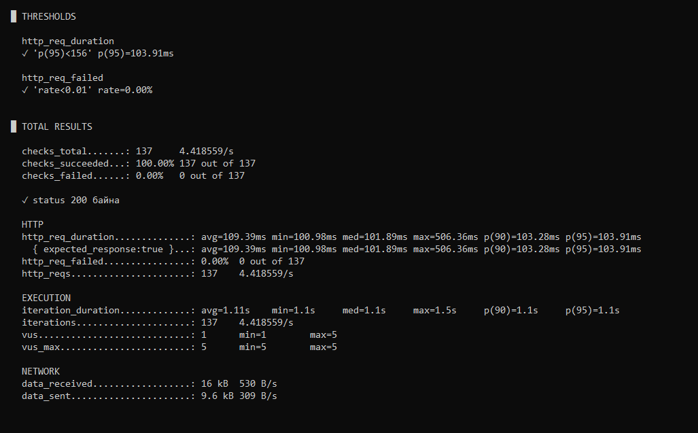

# CSA313 - Лабораторийн ажил №2

## Performance Testing with k6

**Оюутан:** П.Пүрэвдаш  
**Оюутны код:** B232270144

## 1. Зорилго

k6 ашиглан системийн гүйцэтгэлийг өөр өөр ачааллын түвшинд хэмжих, latency, throughput, error rate үзүүлэлтүүдийг харьцуулах, SLO тодорхойлж Threshold ашиглан үнэлэх.

## 2. Туршилтын орчин

- Windows 11 / WSL2 Ubuntu
- Grafana k6
- JavaScript
- Python HTTP Server
- Git, GitHub

### k6 version

```text
k6 v2.4.0 (commit/dd9395906d, go1.26.11, linux/amd64)
```

Хувилбарын мэдээлэл: [k6-version.txt](results/k6-version.txt)

Туршилтын зөвшөөрөгдсөн хаягууд:

- https://test.k6.io
- http://127.0.0.1:8000

Локал сервер нь нэг урсгалаар ажилладаг бөгөөд хүсэлт бүрд 100 ms саатал үүсгэдэг.

## 3. Туршилт ажиллуулах

Анхны baseline:

```bash
k6 run script.js
```

Локал серверийг тусдаа терминал дээр ажиллуулах:

```bash
python3 server.py
```

Локал baseline (5 VU, 30 секунд):

```bash
k6 run local-test.js
```

Ачааллын туршилтууд:

```bash
k6 run --vus 5 --duration 1m local-test.js
k6 run --vus 30 --duration 1m local-test.js
k6 run --vus 100 --duration 1m local-test.js
```

Stages туршилт:

```bash
k6 run stages-test.js
```

Threshold PASS туршилт:

```bash
k6 run threshold-test.js
```

## 4. Baseline үр дүн

| Үзүүлэлт | test.k6.io | Local server |
|---|---:|---:|
| VU | 5 | 5 |
| Duration | 30s | 30s |
| Average | 208.54ms | 109.94ms |
| p90 | 290.16ms | 103.51ms |
| p95 | 310.67ms | 103.95ms |
| Throughput | 6.81 req/s | 4.42 req/s |
| Error rate | 0.00% | 0.00% |
| HTTP requests | 210 | 137 |

Хоёр baseline нь өөр сервер дээр хийгдсэн тул локал ачааллын туршилтын SLO-г зөвхөн локал baseline-д үндэслэн тодорхойлсон.

## 5. Ачааллын туршилтын үр дүн

| VU | Duration | Average | p90 | p95 | Req/s | Error rate |
|---:|---|---:|---:|---:|---:|---:|
| 5 | 1m | 105.97ms | 103.05ms | 103.38ms | 4.52 | 0.00% |
| 30 | 1m | 706.39ms | 800.74ms | 1s | 9.08 | 0.17% |
| 100 | 1m | 10.26s | 58.98s | 58.99s | 5.35 | 23.21% |

30 VU ачааллаас эхлэн хэрэглэгчийн хариу хүлээх хугацаа мэдэгдэхүйц өссөн. 100 VU үед throughput буурч, latency болон error rate огцом нэмэгдсэн.

## 6. Stages туршилт

| Stage | Duration | Target VU |
|---|---|---:|
| Халаалт | 30s | 5 |
| Өсөлт | 1m | 30 |
| Оргил | 30s | 100 |
| Буулт | 30s | 0 |

Нийт үндсэн хугацаа: 150 секунд.

Graceful stop оролцсон бодит хугацаа: 162.6 секунд.

| Үзүүлэлт | Үр дүн |
|---|---:|
| Average | 893.65ms |
| p90 | 810.81ms |
| p95 | 1.11s |
| Throughput | 6.758121 req/s |
| Error rate | 6.36% |
| Нийт хүсэлт | 1099 |
| Амжилттай | 1029 |
| Амжилтгүй | 70 |
| Completed iterations | 1098 |
| Interrupted iterations | 3 |

Stages туршилт нь нэгтгэсэн summary гаргадаг тул 5/30/100 VU түвшний харьцуулалтыг тусдаа ажиллуулсан туршилтуудаас авсан.

## 7. SLO болон Threshold

Локал baseline p95 = 103.95ms.

SLO тооцоолол:

103.95 × 1.5 = 155.925ms ≈ 156ms

Baseline утгаас 50%-ийн нэмэлт хүлцэл олгож p95 босгыг тодорхойлсон. HTTP алдааны зөвшөөрөгдөх хувийг 1%-иас бага байхаар сонгосон.

```javascript
thresholds: {
    http_req_duration: ['p(95)<156'],
    http_req_failed: ['rate<0.01'],
}
```

### 7.1. Автомат Threshold PASS

5 VU, 30 секундын туршилт.

| Үзүүлэлт | Үр дүн |
|---|---:|
| Average | 109.39ms |
| p90 | 103.28ms |
| p95 | 103.91ms |
| Throughput | 4.418559 req/s |
| Error rate | 0.00% |
| HTTP requests | 137 |

| Metric | Threshold | Actual | Result |
|---|---|---|---|
| p95 latency | <156ms | 103.91ms | PASS |
| Error rate | <1% | 0.00% | PASS |

Автомат үнэлгээ: **PASS**

### 7.2. Автомат Threshold FAIL

150 секундын Stages туршилт.

| Metric | Threshold | Actual | Result |
|---|---|---|---|
| p95 latency | <156ms | 1.11s | FAIL |
| Error rate | <1% | 6.36% | FAIL |

Автомат үнэлгээ: **FAIL**

Exit code: 99

Ижил SLO босго ашиглахад бага ачааллын үед PASS, өндөр ачааллын үед FAIL гарсан нь Threshold буюу автомат quality gate-ийн ажиллагааг харуулсан.

### 7.3. SLO харьцуулалт

| Test | Latency | Error rate | Overall | Үнэлгээ |
|---|---|---|---|---|
| Local baseline | PASS | PASS | PASS | Manual |
| 5 VU | PASS | PASS | PASS | Manual |
| 30 VU | FAIL | PASS | FAIL | Manual |
| 100 VU | FAIL | FAIL | FAIL | Manual |
| Threshold test | PASS | PASS | PASS | Automatic |
| Stages | FAIL | FAIL | FAIL | Automatic |

## 8. Нотлох баримтууд

| Туршилт | Log | Screenshot |
|---|---|---|
| Baseline | [Log](results/run-baseline.txt) | [Image](evidence/baseline-5vu.png) |
| Local baseline | [Log](results/run-local-baseline.txt) | [Image](evidence/local-baseline.png) |
| 5 VU | [Log](results/run-05vu.txt) | [Image](evidence/run-05vu.png) |
| 30 VU | [Log](results/run-30vu.txt) | [Image](evidence/run-30vu.png) |
| 100 VU | [Log](results/run-100vu.txt) | [Image](evidence/run-100vu.png) |
| Stages / FAIL | [Log](results/run-stages.txt) | [Image](evidence/run-stages.png) |
| Threshold PASS | [Log](results/run-threshold-pass.txt) | [Image](evidence/run-threshold-pass.png) |

### Threshold PASS



### Threshold FAIL


## 9. Дүгнэлт

Энэхүү лабораторийн ажлаар k6 ашиглан системийн гүйцэтгэлийг бодитоор хэмжсэн. Локал baseline туршилтаар p95 хугацаа 103.95ms, алдааны хувь 0% гарсан. 5 VU ачаалалд сервер тогтвортой ажиллаж, бүх хүсэлт амжилттай болсон. 30 VU ачаалалд throughput 9.08 req/s болж өссөн боловч p95 хугацаа 1 секунд хүрсэн. 100 VU ачаалалд p95 хугацаа 58.99 секунд, алдааны хувь 23.21% болж серверийн гүйцэтгэл мэдэгдэхүйц муудсан. Эдгээр үр дүн нь лекцээр үзсэн latency, throughput болон error rate-ийн хамаарлыг харуулсан. Stages туршилтаар 1099 хүсэлтээс 70 хүсэлт амжилтгүй болж, алдааны хувь 6.36% гарсан. Локал baseline-д үндэслэн p95 SLO босгыг 156ms, error rate босгыг 1%-иас бага байхаар тодорхойлсон. Автомат Threshold туршилтаар 5 VU үед PASS, Stages туршилтаар FAIL гарсан нь SLO болон quality gate-ийн ажиллагааг баталсан. Нэг урсгалтай серверийн бүтэц болон зориудын саатал нь өндөр ачааллын үед гүйцэтгэл хязгаарлагдах боломжит үндсэн шалтгаан болсон.

## 10. AI ашиглалт

ChatGPT-ийг k6 тестийн код боловсруулах, командын заавар авах, хэмжилтийн үр дүнг тайлбарлах болон README баримтжуулалт бэлтгэхэд ашигласан. Туршилтуудыг өөрийн локал орчинд ажиллуулж, бодит үр дүн болон дэлгэцийн зургуудыг хадгалсан.
