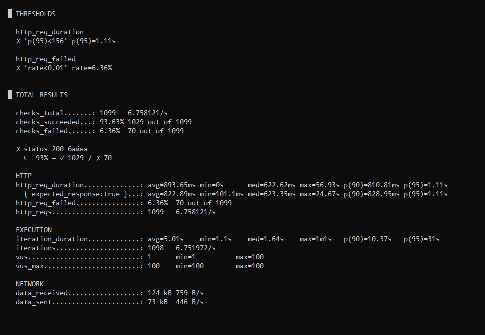

# CSA313 - Лабораторийн ажил №2

## Performance Testing with k6

**Оюутан:** П.Пүрэвдаш  
**Оюутны код:** B232270144

## 1. Зорилго

k6 ашиглан системийн гүйцэтгэлийг өөр өөр ачааллын түвшинд хэмжих, latency, throughput, error rate үзүүлэлтүүдийг харьцуулах, SLO тодорхойлж Threshold ашиглан үнэлэх.

## 2. Туршилтын орчин

- Windows 11 / WSL2 Ubuntu
- k6 v2.4.0
- JavaScript
- Python HTTP Server
- Git, GitHub

k6 хувилбарын мэдээлэл: [k6-version.txt](results/k6-version.txt)

Туршилтын хаягууд:

- https://test.k6.io
- http://127.0.0.1:8000

Локал сервер нь нэг урсгалаар ажилладаг бөгөөд хүсэлт бүрд 100 ms саатал үүсгэдэг.

## 3. Туршилт ажиллуулах

Анхны baseline:

```bash
k6 run script.js
```

Локал сервер:

```bash
python3 server.py
```

Локал baseline (5 VU, 30 секунд):

```bash
k6 run local-test.js
```

Ачааллын туршилтууд:

```bash
k6 run --vus 5 --duration 1m local-test.js
k6 run --vus 30 --duration 1m local-test.js
k6 run --vus 100 --duration 1m local-test.js
```

Stages туршилт:

```bash
k6 run stages-test.js
```

## 4. Baseline үр дүн

| Үзүүлэлт | test.k6.io | Local server |
|---|---:|---:|
| VU | 5 | 5 |
| Duration | 30s | 30s |
| Average | 208.54ms | 109.94ms |
| p90 | 290.16ms | 103.51ms |
| p95 | 310.67ms | 103.95ms |
| Throughput | 6.81 req/s | 4.42 req/s |
| Error rate | 0.00% | 0.00% |
| HTTP requests | 210 | 137 |

Хоёр baseline нь өөр сервер дээр хийгдсэн тул локал ачааллын туршилтын SLO-г зөвхөн локал baseline-д үндэслэн тодорхойлсон.

## 5. Ачааллын туршилтын үр дүн

| VU | Duration | p90 | p95 | Req/s | Error rate |
|---:|---|---:|---:|---:|---:|
| 5 | 1m | 103.05ms | 103.38ms | 4.52 | 0.00% |
| 30 | 1m | 800.74ms | 1s | 9.08 | 0.17% |
| 100 | 1m | 58.98s | 58.99s | 5.35 | 23.21% |

## 6. Stages туршилт

| Stage | Duration | Target VU |
|---|---|---:|
| 1 | 30s | 5 |
| 2 | 30s | 30 |
| 3 | 30s | 100 |
| 4 | 30s | 0 |

Нийт үндсэн хугацаа: 2 минут.

| Үзүүлэлт | Үр дүн |
|---|---:|
| Average | 969.95ms |
| p90 | 796.97ms |
| p95 | 1.56s |
| Throughput | 5.83 req/s |
| Error rate | 9.98% |
| Нийт хүсэлт | 761 |
| Амжилттай | 685 |
| Амжилтгүй | 76 |
| Interrupted iterations | 2 |

## 7. SLO болон Threshold

Локал baseline p95 = 103.95ms.

SLO тооцоолол:

103.95 × 1.5 = 155.925ms ≈ 156ms

Baseline утгаас 50%-ийн нэмэлт хүлцэл олгож p95 босгыг тодорхойлсон. HTTP алдааны зөвшөөрөгдөх хувийг 1%-иас бага байхаар сонгосон.

```javascript
thresholds: {
    http_req_duration: ['p(95)<156'],
    http_req_failed: ['rate<0.01'],
}
```

| Metric | Threshold | Actual | Result |
|---|---|---|---|
| p95 latency | <156ms | 1560ms | FAIL |
| Error rate | <1% | 9.98% | FAIL |

Stages туршилтын автомат үнэлгээ: **FAIL**

Exit code: 99

Бусад туршилтыг ижил SLO-той гараар харьцуулсан үнэлгээ:

| Test | Latency | Error rate | Overall |
|---|---|---|---|
| Local baseline | PASS | PASS | PASS |
| 5 VU | PASS | PASS | PASS |
| 30 VU | FAIL | PASS | FAIL |
| 100 VU | FAIL | FAIL | FAIL |
| Stages | FAIL | FAIL | FAIL |

## 8. Нотлох баримтууд

| Туршилт | Log | Screenshot |
|---|---|---|
| Baseline | [Log](results/run-baseline.txt) | [Image](evidence/baseline-5vu.png) |
| Local baseline | [Log](results/run-local-baseline.txt) | [Image](evidence/local-baseline.png) |
| 5 VU | [Log](results/run-05vu.txt) | [Image](evidence/run-05vu.png) |
| 30 VU | [Log](results/run-30vu.txt) | [Image](evidence/run-30vu.png) |
| 100 VU | [Log](results/run-100vu.txt) | [Image](evidence/run-100vu.png) |
| Stages | [Log](results/run-stages.txt) | [Image](evidence/run-stages.png) |

### Threshold үр дүн



## 9. Дүгнэлт

Энэхүү лабораторийн ажлаар k6 ашиглан системийн гүйцэтгэлийн туршилт хийсэн. Локал baseline туршилтаар p95 хугацаа 103.95ms, алдааны хувь 0% гарсан. 5 VU ачаалалд сервер тогтвортой ажиллаж, бүх хүсэлт амжилттай болсон. 30 VU ачаалалд throughput 9.08 req/s болж өссөн боловч p95 хугацаа 1 секунд хүрсэн. 100 VU ачаалалд p95 хугацаа 58.99 секунд, алдааны хувь 23.21% болж серверийн гүйцэтгэл мэдэгдэхүйц муудсан. Stages туршилтаар 761 хүсэлт илгээж, 76 хүсэлт амжилтгүй болсон. Baseline-ийн p95 утгад үндэслэн SLO босгыг 156ms гэж тодорхойлсон. Stages туршилтын p95 болон error rate үзүүлэлтүүд тогтоосон Threshold шаардлагыг хангаагүй. Нэг урсгалтай серверийн бүтэц болон зориудын саатал нь өндөр ачааллын үед гүйцэтгэл хязгаарлагдах боломжит үндсэн шалтгаан болсон. Цаашид олон урсгалтай сервер ашиглан ижил нөхцөлд дахин туршиж, гүйцэтгэлийн өөрчлөлтийг харьцуулах боломжтой.

## 10. AI ашиглалт

ChatGPT-ийг k6 тестийн код боловсруулах, командын заавар авах, хэмжилтийн үр дүнг тайлбарлах болон README баримтжуулалт бэлтгэхэд ашигласан. Туршилтуудыг өөрийн локал орчинд ажиллуулж, бодит үр дүн болон дэлгэцийн зургуудыг хадгалсан.
